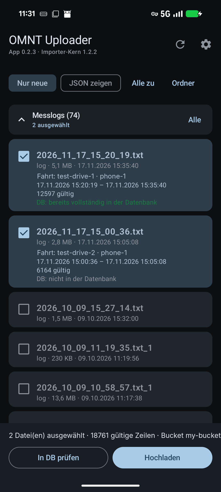
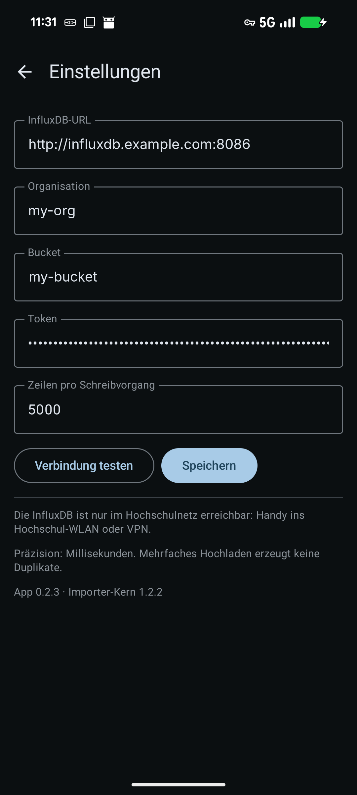

# OMNT Uploader

An Android app that uploads log files recorded by [OpenMobileNetworkToolkit (OMNT)](https://github.com/omnt/OpenMobileNetworkToolkit) to an InfluxDB 2.x server – after the measurement, when a reliable connection is available.

The app finds the OMNT logs on the phone, sorts them by type, checks every line, shows what is already in the database and uploads only the files you select. Nothing is uploaded automatically, and the log files are never modified.

## Why this app exists

We run mobile network measurements with OMNT in the border region between Germany and France. While driving along and across the border, the phones frequently switch between networks and into roaming, and our InfluxDB server is only reachable via VPN. As a result, OMNT's live remote logging often failed and left gaps in the data.

OMNT can also write every measurement to a local log file on the phone, so no data is lost on the device itself. What was missing was a convenient way to get those local logs into the database afterwards – reliably, without duplicates, and without a computer. This app closes that gap: record locally during the drive, upload later from the phone once it has a stable connection.

The app was developed with the help of [Claude](https://claude.ai) (Anthropic).

## Screenshots

<table>
  <tr>
    <td align="center"></td>
    <td align="center"></td>
  </tr>
  <tr>
    <td align="center">Logs grouped by type (Measurement logs, Ping, iPerf3)</td>
    <td align="center">InfluxDB connection settings</td>
  </tr>
</table>

## Features

- **Folder access:** you grant read access to OMNT's folder (usually `Documents/omnt`) once via Android's folder picker. The app only reads; log files are never changed.
- **Automatic detection:** all subfolders are scanned and files are sorted by their content, not by folder name:
  - *Measurement logs* – general OMNT logs (network, signal strength, cell information, location, battery …), `YYYY_MM_DD_hh_mm_ss.txt`, including copies ending in `.txt_1`
  - *Ping* – ping results
  - *iPerf3* – iPerf3 results in line protocol (`<UUID>.txt` / `.lp`)
  - *iPerf3 JSON* – raw iPerf3 output; hidden by default and not importable, because the same values are in the line-protocol file with the same UUID
- **Selection:** tick single files or whole groups; groups can be folded. "New only" hides files already uploaded from this phone.
- **Line validation:** before uploading, every file is analysed – run name (`measurement_name`), device, time range, valid and rejected lines with reasons.
- **Database check:** "Check database" asks InfluxDB, per file, whether its data is already stored – completely, partly (with percentage) or not at all. It compares the distinct timestamps per measurement for the same run, device and time range, so it also detects data written by OMNT's live remote logging. The check never blocks an upload.
- **Safe upload:** valid lines only, gzip-compressed, in batches (default 5,000 lines). Uploading the same file twice creates no duplicates, because InfluxDB overwrites points with identical measurement, tags and timestamp. If the server becomes unreachable, the upload stops at the first connection error, reports how many lines were written, and can simply be repeated later.

### Why lines are validated

OMNT occasionally interleaves two lines while writing a log file, which cuts a timestamp short (e.g. `…provider="fused" 1791536NetworkInformation,…`). InfluxDB rejects a whole batch if a single line is broken. The app therefore only uploads lines that

- start with a known OMNT measurement (`NetworkInformation`, `InterfaceThroughput`, `SignalStrength`, `CellInformation`, `IPAddressInformation`, `Location`, `BuildInformation`, `BatteryInformation`, `Ping`, `Iperf3`),
- have valid tags and fields in line protocol syntax, and
- end with a complete 13-digit millisecond timestamp.

Rejected lines are listed with the reason. They are already broken on the phone and cannot be recovered.

## Requirements

- Android 10 or newer (built and tested on Android 16, Google Pixel 8)
- OMNT with local logging enabled ("Log file" in OMNT's logging settings)
- An InfluxDB 2.x server that the phone can reach (directly, or via VPN)

## Setup

### 1. Create an API token

Use a dedicated token per phone with the minimum rights. In the InfluxDB UI: *Load Data → API Tokens → Generate API Token → Custom API Token*:

- Description: e.g. `omnt-phone-1`
- Buckets → your bucket: **Read** and **Write**, nothing else

Read is needed for the database check, Write for the upload. Copy the token right away; InfluxDB shows it only once.

### 2. Configure the app

1. Open the settings (gear icon) and enter the server URL (e.g. `http://influxdb.example.com:8086`), organisation, bucket and token.
2. Tap **Test connection**, then **Save**.
3. On the main screen, tap **Choose folder** and select OMNT's log folder.

The token is stored in the app's private storage. App backups are disabled so it does not end up in a cloud backup.

To avoid typing a long token on the phone: connect the phone with USB or wireless debugging, put the cursor into the token field, then run on your computer

```bash
read -s TOKEN            # paste the token, press Enter (not shown)
adb shell input text "$TOKEN"
unset TOKEN
```

### 3. Upload

1. Select the files to upload. Check the analysis shown for each file.
2. Optional: **Check database** – see what is already in the database.
3. **Upload**.

## Build

The app is not on Google Play; build it with Android Studio.

1. Install [Android Studio](https://developer.android.com/studio).
2. *File → Open* this folder and wait for the Gradle sync.
3. Connect a phone with USB debugging enabled (or start an emulator) and press **Run ▶**.

If the sync fails with *"Gradle 8.13 is incompatible with the Gradle JVM version 25"*: Android Studio → *Settings → Build, Execution, Deployment → Build Tools → Gradle → Gradle JDK* → `jbr-21`.

The repository contains no Gradle wrapper scripts; Android Studio uses the version from `gradle/wrapper/gradle-wrapper.properties`. To build on the command line, generate the wrapper once with a local Gradle installation: `gradle wrapper`.

To get an APK for installing without a cable: *Build → Generate Signed App Bundle / APK → APK*. Keep the keystore and its password safe and out of the repository – updates must be signed with the same key.

### Tests

Unit tests for the validation rules, the file analysis, the database check query and the upload abort run on the JVM, without a device:

```bash
./gradlew test
```

or right-click `LineProtocolTest` in Android Studio → *Run*.

### Tech stack

Kotlin 2.2, Jetpack Compose (Material 3), Android Gradle Plugin 8.11, compileSdk/targetSdk 36, minSdk 29. No third-party libraries beyond AndroidX; HTTP via `HttpURLConnection`.

## Code overview

| File | Purpose |
| --- | --- |
| `LineProtocol.kt` | Line validation and file analysis (the "importer core") |
| `InfluxClient.kt` | Connection test, gzip batch upload, database check (Flux query) |
| `LogRepository.kt` | Folder scan via the Storage Access Framework, file type detection |
| `MainViewModel.kt` | App state, analysis, check and upload flow |
| `MainActivity.kt` | Compose UI (file list, settings) |
| `Settings.kt` | Settings and list of uploaded files (SharedPreferences) |

The title bar shows two versions, e.g. `App 0.3.0 · Importer core 1.2.2`: the app version, and the version of the importer core (validation rules and upload flow) in `LineProtocol.IMPORTER_CORE_VERSION`. Raise the core version whenever those rules change, so you can tell which rules produced the data.

## Notes

- **HTTP:** many self-hosted InfluxDB servers in internal networks run without TLS, so cleartext HTTP is allowed (`res/xml/network_security_config.xml`). Use HTTPS where possible. The app only talks to the server configured in its settings.
- **Application ID:** `io.github.psch0rr.omntuploader`. If you publish your own build (a fork), change `applicationId` in `app/build.gradle.kts` first; changing it later makes Android treat the app as a different one.
- **Deleting data:** neither the app nor the InfluxDB UI can delete points. Use the influx CLI, e.g. to remove one run:
  ```bash
  influx delete --bucket <BUCKET> \
    --start 1970-01-01T00:00:00Z --stop 2100-01-01T00:00:00Z \
    --predicate 'measurement_name="<RUN_NAME>"'
  ```

## License

[BSD-3-Clause-Clear](LICENSE) (The Clear BSD License) – the same license as OpenMobileNetworkToolkit. Copyright © 2026 Philipp Schorr.

## Disclaimer

This is an independent project and not affiliated with the OpenMobileNetworkToolkit project. "OMNT" refers to the app whose log files this tool imports.
